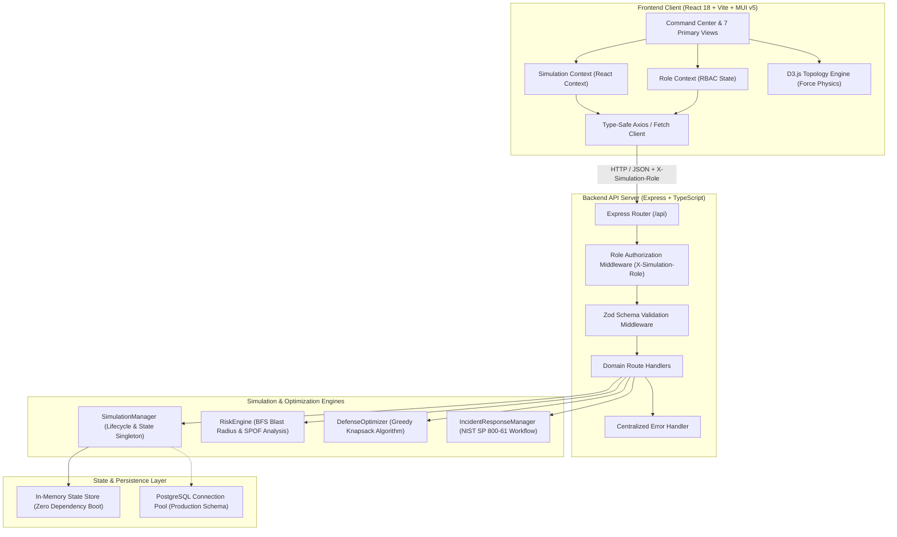

# CyberWar Banking Defense

<p align="center">
  <strong>Enterprise Financial Infrastructure Cyber Warfare Simulation & Defensive Capital Optimization Platform</strong>
</p>

<p align="center">
  
  
  
  
  
  
  
  
</p>

---

## 📌 Executive Overview

**CyberWar Banking Defense** is an enterprise cybersecurity simulation and capital allocation platform designed to model cascading systemic contagion across interconnected tier-1 financial infrastructure. Built with an **npm workspaces TypeScript monorepo** (`React 18 + Vite` frontend, `Express` backend, and `D3.js` network graph engine), the system allows executive decision-makers to simulate sophisticated threat campaigns, optimize defensive security budgets under diminishing returns, analyze systemic single-points-of-failure (SPOFs), and execute structured incident response drills.

### 💼 Key Engineering Capabilities
- **Interactive Force-Directed Network Topology:** Architected an interactive D3.js (v7) physics-driven graph representing 12 tier-partitioned banking assets (DMZ, Application, Secure Data, Third-Party) with real-time health degradation, dynamic threat infection conduits, and pan/zoom/drag controls.
- **Defensive Capital Knapsack Optimizer:** Implemented a submodular greedy Knapsack optimization algorithm that maximizes mitigation efficacy across a constrained $1,000,000 capital budget and 10 enterprise controls, accounting for non-linear diminishing returns across multi-vector attack surfaces.
- **Graph Theory & Systemic Risk Engine:** Built a systemic resilience engine employing Breadth-First Search (BFS) blast-radius calculation, degree centrality analysis, and single-point-of-failure (SPOF) identification to calculate real-time monetary exposure across transactional core ledgers and SWIFT gateways.
- **NIST SP 800-61 Incident Response Lifecycle:** Engineered a 4-state incident triage engine (Detected, Acknowledged, Contained, Recovered) paired with an interactive 5-stage decision drill featuring real-time response latency scoring, CISO severity reclassification, and penalty tracking.
- **Role-Based Perspective Architecture (RBAC):** Designed client-side dynamic views and strict backend authorization middleware enforcing 5 distinct operational perspectives: **CISO**, **Red Team Lead**, **Bank Examiner (Regulator)**, **Cyber Risk Underwriter**, and **Business Continuity Director**.
- **Rigorous Test Suite & Browser Automation:** Achieved 100% pass rate across **48 Vitest unit, integration, and invariant tests**, complemented by a custom **headless Chrome DevTools Protocol (CDP)** automated browser verification suite guaranteeing zero console errors and full UI fidelity.
- **Dual-Layer Persistence:** Engineered an instantaneous in-memory singleton state engine with full relational PostgreSQL connection pooling and production-ready database migrations (`schema.sql`).

---

## 🏗️ Architecture & System Design

The platform uses a clean, decoupled client-server monorepo architecture with type-safe contracts and runtime schema validation.



---

## 🛠️ Technology Stack

| Domain | Technology | Version | Purpose & Architectural Role |
| :--- | :--- | :--- | :--- |
| **Frontend Framework** | React | `^18.2.0` | Declarative UI, component lifecycle, custom hooks |
| **Build & Tooling** | Vite | `^5.2.8` | High-speed HMR, ES module bundling, tree-shaking |
| **Component Library** | Material UI (MUI) | `^5.15.15` | Polished command-center design system, dark/light modes |
| **Data Visualization** | D3.js | `^7.9.0` | Force-directed graph simulation, collision physics, dynamic SVG |
| **Backend Framework** | Express | `^4.19.2` | RESTful API endpoints, request routing, role authorization |
| **Runtime Environment** | Node.js | `>=20.0.0` | Server runtime with native ES modules support |
| **Static Typing** | TypeScript | `^5.4.5` | Strict end-to-end type safety across monorepo packages |
| **Schema Validation** | Zod | `^3.23.8` | Runtime validation for incoming HTTP request payloads |
| **Testing Framework** | Vitest | `^1.5.0` | Unit, invariant, and integration test execution |
| **API Integration Tests**| Supertest | `^6.3.4` | In-memory HTTP endpoint testing and assertion |
| **Browser Automation** | Chrome DevTools Protocol | Native WS | Automated headless Chrome end-to-end browser verification |
| **Monorepo Management** | npm Workspaces | Native | Clean multi-package dependency resolution |

---

## ⚡ Core Capabilities & Mathematical Formulations

### 1. Banking Network Topology & Critical Infrastructure
The platform models 12 financial infrastructure assets spanning 4 structural network tiers, with strict operational health boundaries ($[0\%, 100\%]$):

| Network Tier | Asset Name | Criticality | Target RTO | Target RPO | Financial Exposure |
| :--- | :--- | :---: | :---: | :---: | :---: |
| **DMZ** | Online Banking Web & Mobile Portal | `HIGH` | 2.0 hrs | 1.0 hr | $2,500,000 |
| **Application** | Internal API Gateway & Microservices Hub | `CRITICAL` | 1.0 hr | 0.5 hr | $4,500,000 |
| **Application** | Authentication & Identity Provider (IAM/IdP) | `CRITICAL` | 1.0 hr | 0.5 hr | $6,000,000 |
| **Secure Data** | Core Banking Ledger & Transaction Engine | `CRITICAL` | 0.5 hr | 0.1 hr | $18,000,000 |
| **Secure Data** | Customer PII & Account Relational Database | `CRITICAL` | 1.0 hr | 0.25 hr | $14,000,000 |
| **Application** | Payment Processing Gateway | `CRITICAL` | 1.0 hr | 0.5 hr | $8,500,000 |
| **Application** | AI Fraud Detection & AML Monitoring Engine | `HIGH` | 4.0 hrs | 2.0 hrs | $3,000,000 |
| **DMZ** | ATM Switch & Branch Kiosk Network | `MODERATE` | 6.0 hrs | 2.0 hrs | $1,800,000 |
| **Secure Data** | Immutable Backup & Disaster Recovery Vault | `HIGH` | 1.0 hr | 0.1 hr | $5,000,000 |
| **Third-Party** | Third-Party Clearinghouse & Cloud PSP | `HIGH` | 2.0 hrs | 1.0 hr | $4,000,000 |
| **Secure Data** | SWIFT Alliance & Wholesale Settlement Terminal | `CRITICAL` | 0.5 hr | 0.1 hr | $15,000,000 |
| **DMZ** | Enterprise Remote Access & Jump Box Gateway | `MODERATE` | 4.0 hrs | 2.0 hrs | $1,200,000 |

### 2. Defensive Capital Allocation & Knapsack Optimization
Security officers allocate a fixed **$1,000,000 USD** budget across 10 modular controls. The system incorporates submodular diminishing returns when multiple controls protect against the same attack vector $v$:

$$\text{Unmitigated}(v) = \prod_{c \in \text{ActiveControls}} \left(1 - 0.82 \times \text{effectiveness}(c, v)\right)$$

$$\text{MitigationRate}(v) = \min\left(0.95, \, 1 - \text{Unmitigated}(v)\right)$$

The greedy Knapsack optimizer computes marginal mitigation efficiency per dollar:

$$\text{MarginalUtility}(c) = \frac{\sum_{v} \Delta \text{Mitigation}(c, v) \times \text{VectorWeight}(v)}{\text{Cost}(c)}$$

Controls are greedily selected until the budget boundary is exhausted, generating an optimal balance between perimeter defense and core ledger isolation.

### 3. Dynamic Systemic Risk & Blast Radius Scoring
Real-time risk scoring combines vulnerability metrics, topology concentration, and active security incidents:

$$\text{RawRisk} = 0.30 \cdot \text{AvgVuln} + 0.25 \cdot \text{ConcentrationRisk} + 0.15 \cdot \text{ThirdPartyRisk} + 0.30 \cdot \text{DegradationScore}$$

$$\text{ControlDampener} = \min\left(0.60, \, |\text{ActiveControls}| \times 0.06\right)$$

$$\text{IncidentPenalty} = \min\left(25, \, \sum_{i \in \text{ActiveIncidents}} \text{SeverityWeight}(i) \times \text{StatusFactor}(i)\right)$$

$$\text{OverallRiskScore} = \min\left(99, \, \max\left(10, \, \text{round}\left(\text{RawRisk} \times (1 - \text{ControlDampener}) + \text{IncidentPenalty}\right)\right)\right)$$

### 4. 6 Deterministic Attack Vectors
The simulation models multi-stage cyber warfare kill-chains:
- **DDoS Volumetric Surge:** Targets perimeter portals, propagating to Layer-7 HTTP exhaustion on API gateways.
- **Ransomware Contagion:** Spear-phishing entry followed by lateral movement, credential dumping, and ledger snapshot encryption.
- **Targeted Data Exfiltration:** SQL injection and GraphQL parameter tampering with outbound DNS tunneling.
- **SWIFT Alliance Wire Tampering:** Supply-chain memory injection targeting interbank settlement verification routines.
- **Dual-Zone Cloud Infrastructure Disruption:** BGP route poisoning severing third-party clearinghouse rails.
- **Credential Stuffing Wave:** Distributed botnet attack targeting OAuth2/SAML identity providers.

---

## 🔒 Security Architecture & Role-Based Perspectives (RBAC)

The application enforces 5 role-based perspectives via client state and server-side HTTP header authorization (`X-Simulation-Role`):

| Role | Operational Scope | Permitted Actions | Guarded Actions (HTTP 403) |
| :--- | :--- | :--- | :--- |
| **CISO** | Strategic Risk Governance | Full command authority: budget allocation, Knapsack optimizer, incident triage, severity reclassification, round progression. | *None (Full Administrative Authority)* |
| **Red Team** | Adversary Simulation | Select attack scenarios, step kill-chain phases, evaluate bypass rates. | Cannot deploy capital budget or reclassify incidents. |
| **Regulator** | Supervisory Compliance | Read-only resilience examination, DORA/FFIEC compliance audit, export logs. | Cannot deploy controls, step attacks, or modify triage states. |
| **Underwriter** | Actuarial Risk Modeling | Read-only financial balance sheet modeling, maximum probable loss (PML) evaluation. | Cannot deploy controls, step attacks, or modify triage states. |
| **Continuity Officer** | Infrastructure Resilience | Incident containment, backup restoration, hot-site failover, round advancement. | Cannot deploy defensive budget or reclassify incident severity. |

---

## 🖥️ Application Command Center Views

The platform provides 7 specialized views within an intuitive operational command center:

```
┌──────────────────────────────────────────────────────────────────────────┐
│ CYBERWAR BANKING DEFENSE [COMMAND CENTER]  ● ROUND 1/5  HEALTH: 84% [CISO]│
├──────────────┬───────────────────────────────────────────────────────────┤
│ Active Role  │ [Dashboard View]                                          │
│ CISO Deck    │ ┌────────────────────────────────────┐ ┌────────────────┐ │
│              │ │ D3 Network Topology Visualization  │ │ Telemetry HUD  │ │
│ [Dashboard]  │ │ (12 Interactive Nodes & Conduits)  │ │ Risk: 42/100   │ │
│ [Topology]   │ │                                    │ │ Health: 84%    │ │
│ [Simulator]  │ └────────────────────────────────────┘ └────────────────┘ │
│ [Defenses]   │ ┌───────────────────────────────────────────────────────┐ │
│ [Incidents]  │ │ Live Telemetry Stream / Critical Asset Status Matrix  │ │
│ [Risk]       │ └───────────────────────────────────────────────────────┘ │
│ [Reports]    │                                                           │
└──────────────┴───────────────────────────────────────────────────────────┘
```

1. **Executive Dashboard (`/`):** Unified situational awareness hub featuring the live D3.js topology, 2x2 HUD telemetry matrix (Risk Score, Health, Incidents, Budget), and live breach events.
2. **Infrastructure Topology (`/infrastructure`):** Detailed asset inspector with network-tier filters, RTO/RPO metrics, and incoming/outgoing dependency graphs.
3. **Attack Simulator (`/simulator`):** Multi-stage kill-chain execution console with financial damage telemetry and real-time defense deflection metrics.
4. **Defense Allocation (`/defense`):** Capital allocation interface with $1M budget tracking, aggregate deflection chips, and one-click Knapsack optimization.
5. **Incident Response Center (`/incident`):** NIST SP 800-61 breach management console with asset isolation, backup recovery, and interactive 5-stage graded decision drills.
6. **Systemic Risk Deck (`/risk`):** Graph centrality analysis, Single Point of Failure (SPOF) warnings, and BFS cascading blast-radius calculations.
7. **Reports & Audit History (`/reports`):** Multi-round comparative analytics comparing historical rounds against the live active session, with one-click JSON audit and CSV timeline exports.

---

## 🧪 Testing, Quality Assurance & Verification

The repository includes a comprehensive testing matrix covering unit logic, invariant boundaries, API integration, and headless browser automation.

```bash
# Run Vitest Unit, Invariant & Integration Test Suite (48 passing tests)
npm test

# Run Headless Chrome CDP Browser Automation (10 passing tests)
node scripts/browserE2E.mjs

# Run Strict TypeScript Static Type Checking
npm run typecheck

# Compile Production Frontend & Backend Bundles
npm run build
```

### Verified Test Matrix

| Test Suite | Framework / Tool | Verified Result | Specs Covered |
| :--- | :--- | :---: | :--- |
| **Comprehensive Acceptance Suite** | Vitest (`server/src/test/`) | **14 / 14 PASSED** | RBAC validation, 6 attack vectors, Knapsack optimizer, asset invariants, JSON/CSV exports. |
| **E2E Major Validation Suite** | Vitest (`server/src/test/`) | **8 / 8 PASSED** | Multi-round lifecycles, health boundaries, audit log preservation. |
| **API Integration Suite** | Vitest + Supertest | **7 / 7 PASSED** | HTTP routes, 404 handlers, Zod schema validation errors. |
| **Simulation Unit Suites** | Vitest | **19 / 19 PASSED** | Risk scoring formulas, NIST decision scoring, Knapsack utility ranking. |
| **Headless Browser E2E Automation**| Chrome DevTools Protocol | **10 / 10 PASSED** | DOM rendering, 7-page navigation, role switcher, D3 SVG elements, 0 console exceptions. |
| **Type Integrity Check** | TypeScript `tsc --noEmit` | **0 Errors** | Strict type-checking across both `client` and `server` packages. |

---

## 🚀 Quickstart & Local Development

### Prerequisites
- **Node.js:** `>= 18.0.0` (LTS v20+ recommended)
- **npm:** `>= 9.0.0`
- **Google Chrome:** Required for headless browser CDP verification scripts

### Step-by-Step Setup

1. **Clone the Repository:**
   ```bash
   git clone https://github.com/kittu7738/CyberWar_Banking_Defense.git
   cd CyberWar_Banking_Defense
   ```

2. **Install Workspace Dependencies:**
   ```bash
   npm install
   ```

3. **Start the Development Platform:**
   ```bash
   npm run dev
   ```
   *This concurrently starts:*
   - Backend API Server: `http://localhost:4000`
   - Frontend Command Center: `http://localhost:5173`

4. **Verify Deployment Health:**
   - Command Center UI: [http://localhost:5173/](http://localhost:5173/)
   - Backend API Heartbeat: [http://localhost:4000/api/health](http://localhost:4000/api/health)

---

## ⚙️ Configuration & Environment Variables

Create a `.env` file in `server/` (or configure via your deployment environment):

| Variable | Type | Default Value | Description |
| :--- | :---: | :---: | :--- |
| `PORT` | Number | `4000` | Port for the Express backend server |
| `NODE_ENV` | String | `development` | Environment mode (`development`, `test`, `production`) |
| `CLIENT_URL` | String | `http://localhost:5173` | Allowed CORS origin for frontend client |
| `DATABASE_URL` | String | *(empty)* | Optional PostgreSQL connection string (defaults to in-memory store) |
| `DEFAULT_DEFENSE_BUDGET`| Number | `1000000` | Security capital budget in USD |
| `MAX_SIMULATION_ROUNDS` | Number | `5` | Maximum simulation rounds per session |

---

## 📁 Repository Structure

```
CyberWar_Banking_Defense/
├── package.json                      # Root monorepo workspace configuration
├── scripts/
│   └── browserE2E.mjs                # Headless Chrome CDP browser automation runner
├── client/                           # React 18 + Vite Frontend Application
│   ├── package.json
│   ├── tsconfig.json
│   ├── vite.config.ts
│   └── src/
│       ├── api/                      # Type-safe REST API client methods
│       ├── components/
│       │   ├── Common/               # StatCard, RiskBadge, ConfirmDialog
│       │   ├── Dashboard/            # Role-specific perspective decks (CISO, Red Team, etc.)
│       │   ├── Layout/               # Header, Sidebar, Command HUD components
│       │   └── NetworkGraph/         # Interactive D3NetworkGraph SVG topology component
│       ├── context/                  # SimulationContext and RoleContext state providers
│       ├── types/                    # Shared TypeScript interfaces & types
│       ├── utils/                    # Role capabilities and formatters
│       ├── views/                    # 7 Primary Application Views
│       └── theme.ts                  # Command-center Material UI theme definition
└── server/                           # Express + TypeScript Backend API Application
    ├── package.json
    ├── tsconfig.json
    ├── vitest.config.ts
    └── src/
        ├── app.ts                    # Express application factory & middleware chain
        ├── server.ts                 # HTTP server entrypoint
        ├── db/                       # PostgreSQL connection pool & schema.sql migrations
        ├── middleware/               # roleAuth, Zod validator, centralized errorHandler
        ├── routes/                   # Domain API routers (assets, defense, simulation, etc.)
        ├── simulation/               # Domain engines (attacks, defense, risk, NIST IR)
        ├── test/                     # 48 Vitest automated test suites
        └── types/                    # Domain data contracts
```

---

## ⚖️ License & Ethical Disclaimer

### License
This project is open-source and released under the [MIT License](LICENSE).

### Ethical & Synthetic Simulation Notice
This platform is an **educational and risk modeling simulation environment** built strictly for defensive cybersecurity training, architectural evaluation, and portfolio demonstration. All network topology nodes, incident payloads, financial losses, and vulnerability metrics are **100% synthetic mathematical abstractions**. No real exploits, external attack packets, or live financial infrastructure connections are utilized.

---

<p align="center">
  <strong>Developed by <a href="https://github.com/kittu7738">Anjan Prasad Cherukuthota</a></strong><br>
  <em>Cybersecurity & Systems Engineering</em>
</p>
